<h1 align="center">Planejador</h1>

<p align="center">
  <b>SaaS de agendamento multi-tenant para negócios que atendem com hora marcada</b><br/>
  <i>Multi-tenant scheduling SaaS for appointment-based businesses — salons, clinics, dental offices, studios</i>
</p>

<p align="center">
  <a href="https://planejador-psi.vercel.app"><b>▶ Demo ao vivo · Live demo</b></a>
</p>

<p align="center">
  
  
  
  
  
  
  
</p>

---

## ✨ Visão geral · Overview

O **Planejador** é um sistema de agendamento para **qualquer negócio que atende com hora
marcada** — salões, barbearias, clínicas, consultórios, estúdios. **Cada negócio é um _tenant_
com dados totalmente isolados** — equipe, serviços, profissionais, agenda e identidade visual
próprias. O modelo é genérico; a primeira versão e a demo estão configuradas como **salão de
beleza**, e é assim que as telas abaixo aparecem. Os profissionais gerenciam horários,
**evitam conflitos de agenda** e organizam seus clientes num painel simples e rápido.

*Built for any appointment-based business — salons, clinics, dental offices, studios. Each
business is a fully isolated tenant with its own team, services, professionals, calendar and
branding. The model is generic; the first version and the demo are set up as a beauty salon,
which is what the screenshots below show.*

> 📌 Este é o **repositório-vitrine** do projeto. O código-fonte completo é **privado**
> (produto comercial). Aqui ficam a **demo ao vivo**, **capturas de tela**, a
> **arquitetura** e **trechos curados** do código.
>
> *This is the project's **showcase repository**. The full source code is **private**
> (commercial product). Here you'll find the **live demo**, **screenshots**, the
> **architecture** and **curated code excerpts**.*

---

## 🖥️ Telas · Screenshots

**Agenda — visão por profissional** (eventos coloridos por serviço, sem sobreposição)<br/>
*Calendar — per-professional view (events coloured by service, no overlaps)*

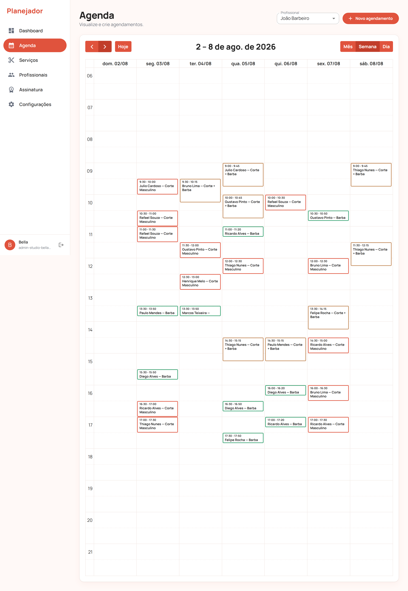

<table>
  <tr>
    <td width="50%" valign="top"><b>Dashboard</b><br/>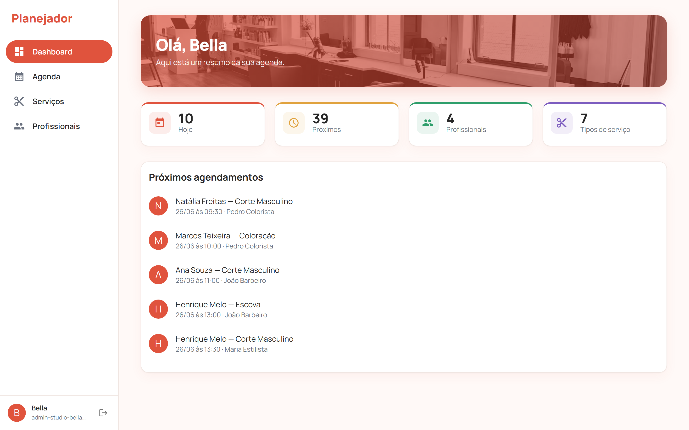</td>
    <td width="50%" valign="top"><b>Detalhe do agendamento</b><br/><i>Appointment details</i><br/>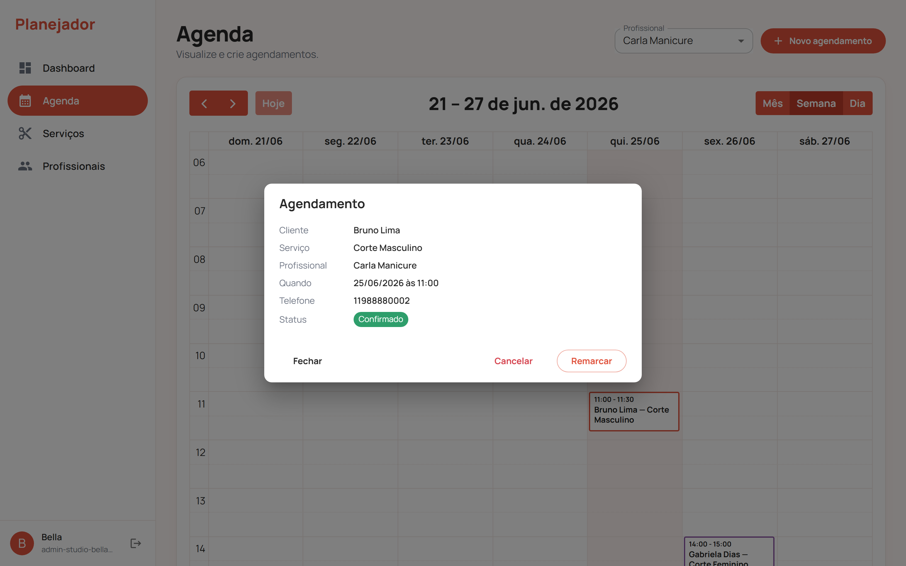</td>
  </tr>
  <tr>
    <td valign="top"><b>Todos os profissionais (visão Dia)</b><br/><i>All professionals (Day view)</i><br/>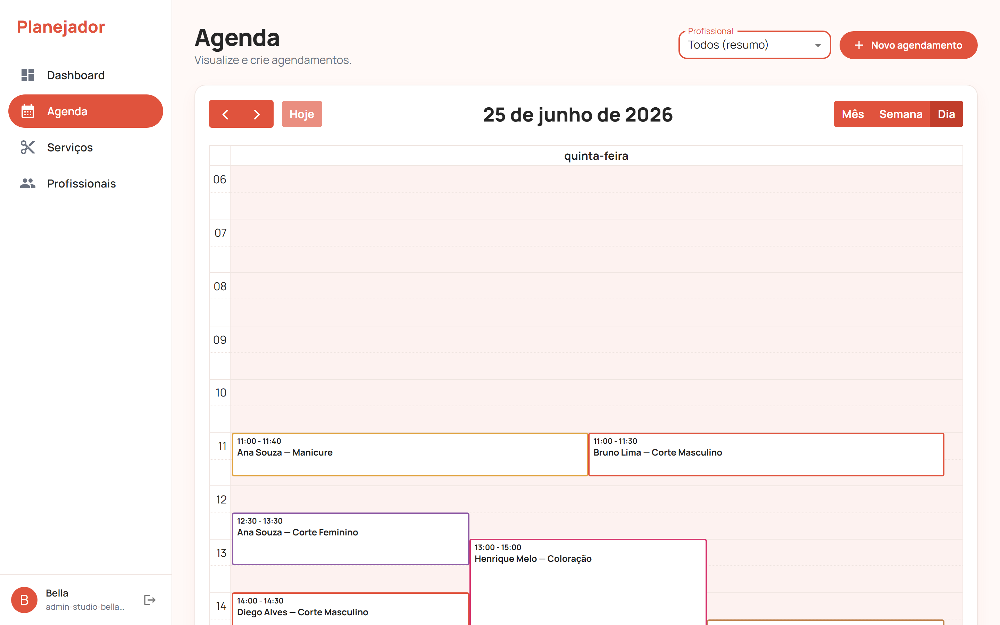</td>
    <td valign="top"><b>Serviços</b><br/><i>Services</i><br/>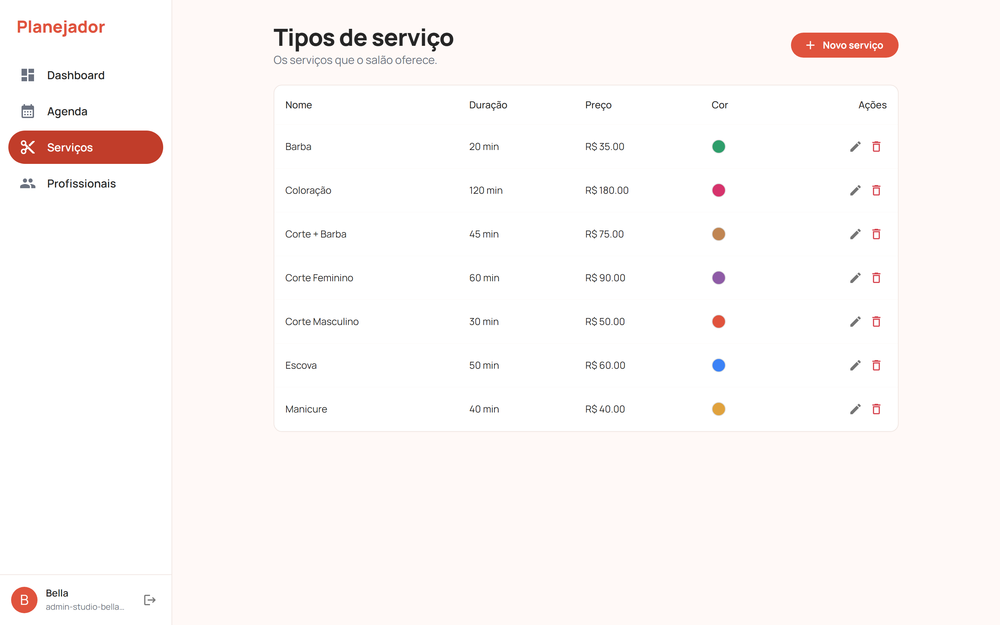</td>
  </tr>
  <tr>
    <td valign="top"><b>Profissionais</b><br/><i>Professionals</i><br/>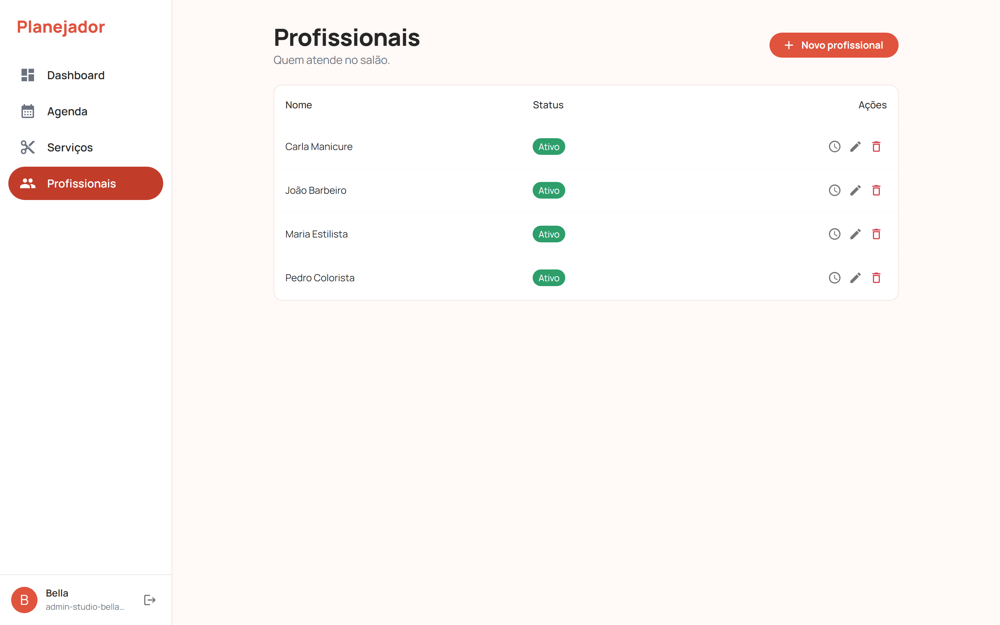</td>
    <td valign="top"><b>Login</b><br/>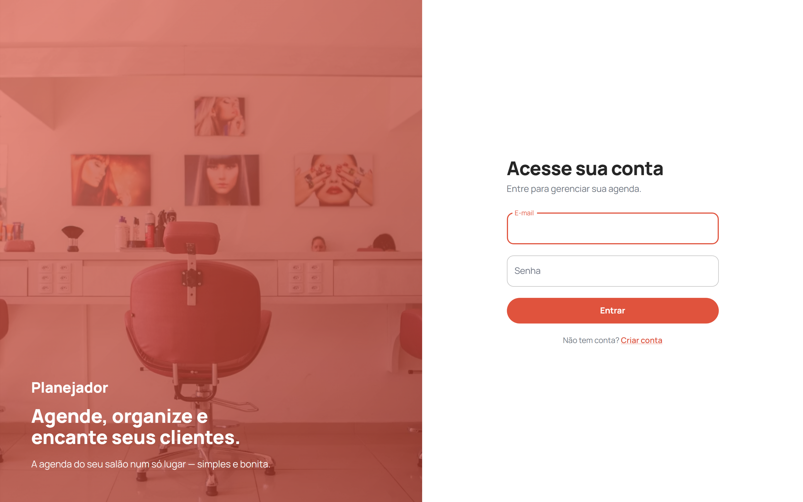</td>
  </tr>
</table>

**📱 No celular · On mobile** — a agenda vira **lista da semana** (texto por extenso, sem estourar as bordas) e o nome do salão ganha **destaque** no topo.<br/>
*The calendar becomes a **weekly list** (full text, nothing overflowing the edges) and the salon's name is **highlighted** at the top.*

<table>
  <tr>
    <td width="50%" valign="top" align="center"><b>Agenda — lista da semana</b><br/><i>Calendar — weekly list</i><br/>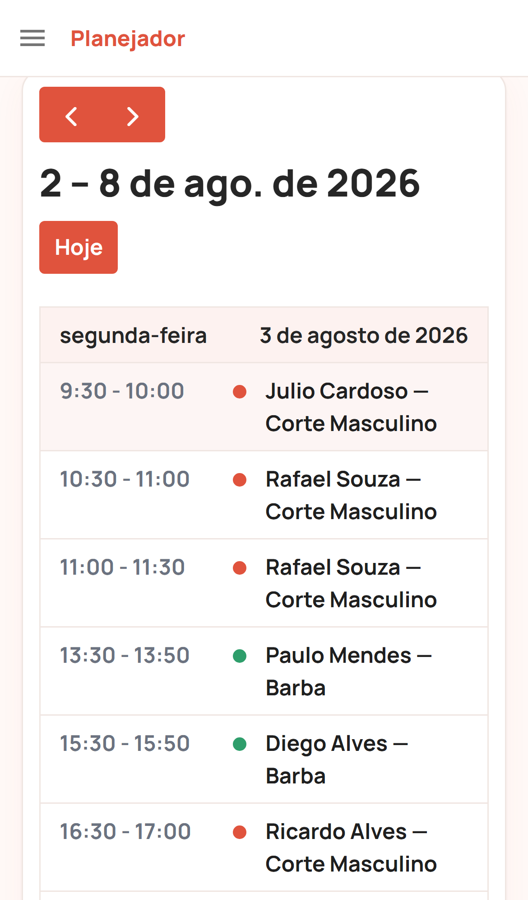</td>
    <td width="50%" valign="top" align="center"><b>Dashboard</b><br/>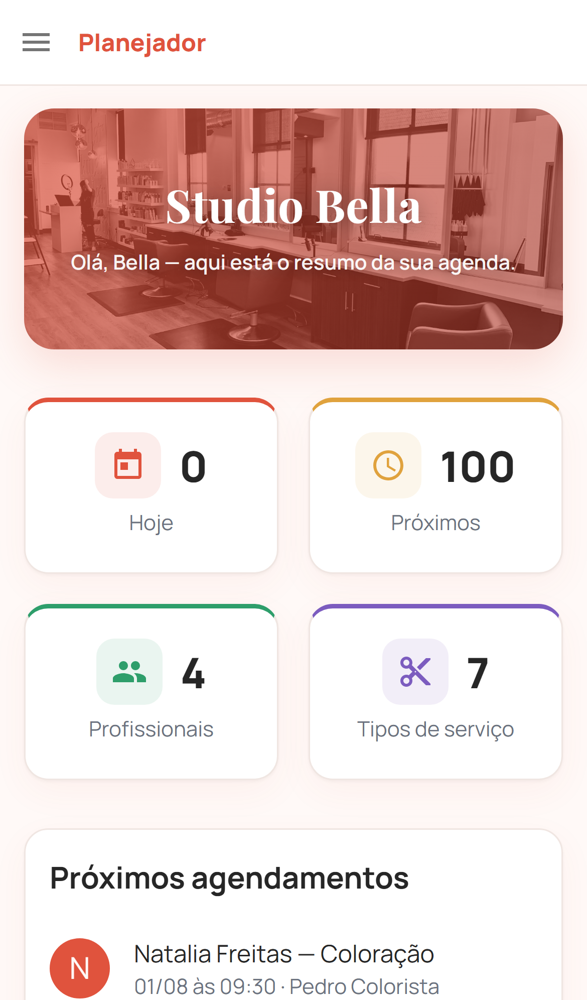</td>
  </tr>
</table>

---

## 🤖 Maria Júlia — atendimento por IA no WhatsApp · AI assistant on WhatsApp

A **Maria Júlia** atende no **WhatsApp oficial** (Meta Cloud API) e **agenda, remarca e
cancela sozinha**, no número real do salão, em produção. A conversa abre com uma saudação
pela hora do dia e três botões; daí em diante o fluxo é **clicável e determinístico**
(serviço → profissional → dia → horário), montado pelo **motor de disponibilidade** do
backend. O modelo de linguagem entra só para conversar e entender pedidos livres — **quem
escolhe horário e grava no banco é o código**, então ela não inventa horário nem promete o
que a agenda não tem.

*Maria Júlia answers on official WhatsApp (Meta Cloud API) and books, reschedules and
cancels on her own. The LLM handles conversation; the backend owns availability and writes
to the database — so the flow is deterministic and free of hallucinated time slots.*

<table>
  <tr>
    <td width="50%" valign="top"><b>Abertura — saudação e três caminhos</b><br/><i>Opening — greeting and three paths</i><br/>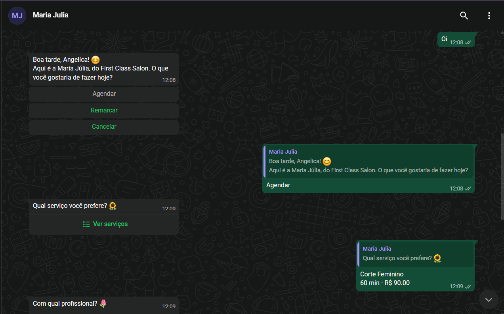</td>
    <td width="50%" valign="top"><b>Agendando por menus clicáveis</b><br/><i>Booking through clickable menus</i><br/>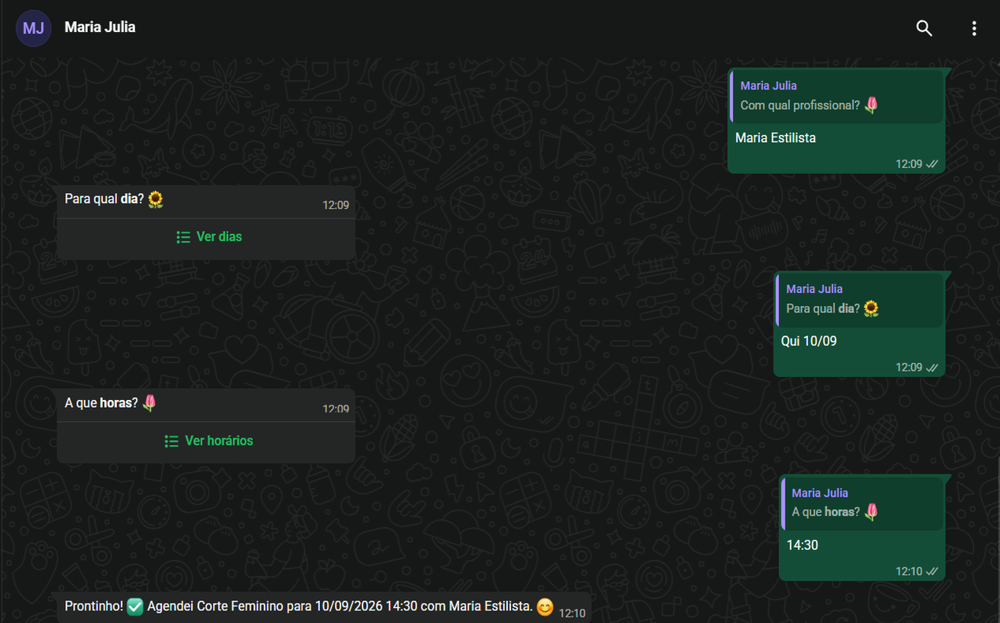</td>
  </tr>
</table>

**A prova · The proof** — o agendamento nasceu no WhatsApp e aparece **na agenda do
salão**, quinta 10/09 às 14:30, no mesmo minuto:<br/>
*the appointment was born on WhatsApp and shows up **on the salon's calendar**, Thursday
Sep 10 at 2:30 pm, within the same minute:*

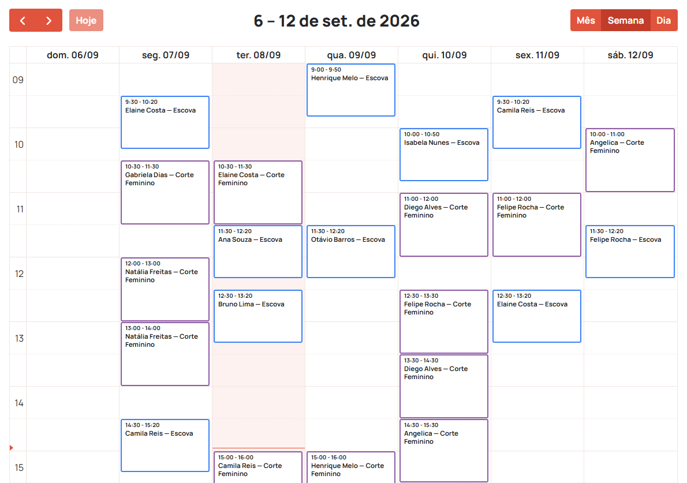

- **Sem alucinação**: os horários oferecidos vêm do mesmo motor de disponibilidade da
  agenda web — jornada de trabalho, folgas e agendamentos já existentes.<br/>
  ***No hallucination**: the offered slots come from the same availability engine as the web
  calendar — working hours, days off and existing appointments.*
- **Barato de rodar**: cumprimento, agradecimento e os menus são respondidos pelo próprio
  código, sem chamar o modelo.<br/>
  ***Cheap to run**: greetings, thank-yous and the menus are answered by the code itself,
  without calling the model.*
- **Uma conversa por cliente**: histórico e contexto persistidos, para remarcar e cancelar
  sem repetir pergunta.<br/>
  ***One conversation per customer**: history and context are persisted, so rescheduling and
  cancelling never repeat a question.*

---

## 🧱 Stack

| Camada · Layer | Tecnologias · Technologies |
|---|---|
| **Backend** | Python · Django · Django REST Framework · JWT (SimpleJWT) |
| **Frontend** | React · TypeScript · Vite · Material UI · React Query · Zustand · FullCalendar |
| **IA · WhatsApp** | Meta Cloud API · agente com function calling (Gemini/Groq) · menus interativos<br/>*Meta Cloud API · function-calling agent (Gemini/Groq) · interactive menus* |
| **Banco · Database** | PostgreSQL |
| **Qualidade · Quality** | 396 testes de backend · 97% de cobertura · 41 de frontend · 6 cenários E2E (Playwright)<br/>*396 backend tests · 97% coverage · 41 frontend tests · 6 E2E scenarios (Playwright)* |
| **Deploy** | Vercel (front) · Render (API) · Supabase (DB) |

---

## 🏛️ Arquitetura & destaques · Architecture & highlights

- **Multi-tenancy** (_shared-schema_): coluna `tenant` em todas as tabelas + um
  `TenantFilterMixin` que **isola os dados de cada salão automaticamente**, sem repetir
  filtros em cada view.<br/>
  *A `tenant` column on every table + a `TenantFilterMixin` that **isolates each salon's
  data automatically**, with no filters repeated in every view.*
- **Motor de disponibilidade**: calcula horários livres respeitando a **jornada de
  trabalho**, **exceções** (folgas e horários especiais) e os **agendamentos existentes**,
  com encaixe sequencial e descarte de horários no passado.<br/>
  ***Availability engine**: computes free slots honouring **working hours**, **exceptions**
  (days off and special hours) and **existing appointments**, with sequential fitting and
  past slots discarded.*
- **Padrão Selectors/Services**: regra de negócio separada das views → testável sem subir
  um request HTTP.<br/>
  ***Selectors/Services pattern**: business rules kept out of the views → testable without
  an HTTP request.*
- **Autenticação JWT** com papéis (`SAAS_ADMIN` / `BUSINESS_ADMIN` / `OPERATOR`).<br/>
  ***JWT authentication** with roles (`SAAS_ADMIN` / `BUSINESS_ADMIN` / `OPERATOR`).*
- **Datas em UTC** no banco; fuso do salão aplicado só na exibição.<br/>
  ***UTC datetimes** in the database; the salon's time zone is applied only on display.*
- **396 testes, 97% de cobertura** no backend (a CI reprova abaixo de 90%), mais E2E de
  API e de navegador (Playwright).<br/>
  ***396 tests, 97% backend coverage** (CI fails below 90%), plus API and browser E2E
  (Playwright).*

---

## 🔎 Trechos de código · Code highlights

> Amostras **curadas** (não-rodáveis) que mostram o estilo de código e as decisões de
> arquitetura. Arquivos completos em [`snippets/`](snippets/).
>
> *Curated (non-runnable) samples showing the coding style and architectural decisions. Full
> files in [`snippets/`](snippets/).*

### 1. Isolamento multi-tenant · Multi-tenant isolation — `TenantFilterMixin`

Toda ViewSet que herda este mixin passa a filtrar os dados pelo salão do usuário logado e
injeta o `tenant` ao criar registros. **Isolamento por construção** — um salão nunca
enxerga dados de outro.

*Every ViewSet that inherits this mixin filters data by the logged-in user's salon and
injects the `tenant` when creating records. **Isolation by construction** — a salon never
sees another salon's data.*

```python
class TenantFilterMixin:
    """Garante isolamento por tenant em ViewSets/Generics."""

    def get_queryset(self):
        queryset = super().get_queryset()
        user = self.request.user
        if user.is_authenticated and getattr(user, 'tenant_id', None):
            return queryset.filter(tenant=user.tenant)
        return queryset.none()

    def perform_create(self, serializer):
        tenant = getattr(self.request.user, 'tenant', None)
        if tenant is None:
            raise PermissionDenied('Sua conta não está vinculada a um negócio. …')
        serializer.save(tenant=tenant)
```

### 2. Motor de disponibilidade · Availability engine — `get_available_slots`

Dado um profissional, uma data e um serviço, devolve os horários livres. Considera a
jornada, as exceções e os agendamentos já marcados, fazendo **encaixe sequencial**.

*Given a professional, a date and a service, returns the free slots. It takes working hours,
exceptions and existing bookings into account, with **sequential fitting**.*

```python
def get_available_slots(professional, date, service_type):
    """Horários livres de um profissional numa data, para um serviço."""
    duration = timedelta(minutes=service_type.duration_minutes)
    now = timezone.now()

    # Agendamentos que ainda ocupam a agenda nesse dia, em UTC.
    day_start = datetime.combine(date, datetime.min.time(), tzinfo=BUSINESS_TZ)
    day_end = day_start + timedelta(days=1)
    busy = list(
        Appointment.objects.filter(
            professional=professional,
            status__in=Appointment.ACTIVE_STATUSES,
            start_datetime__lt=day_end,
            end_datetime__gt=day_start,
        ).values_list('start_datetime', 'end_datetime')
    )

    slots = []
    for start_time, end_time in _windows_for_date(professional, date):
        cursor = datetime.combine(date, start_time, tzinfo=BUSINESS_TZ)
        window_end = datetime.combine(date, end_time, tzinfo=BUSINESS_TZ)

        while cursor + duration <= window_end:
            slot_end = cursor + duration
            overlaps = any(b_start < slot_end and cursor < b_end for b_start, b_end in busy)
            if not overlaps and cursor >= now:
                slots.append(cursor)
                cursor = slot_end
            elif overlaps:
                # Pula até o fim do agendamento que conflita (encaixe sequencial).
                cursor = max(b_end for b_start, b_end in busy if b_start < slot_end and cursor < b_end)
            else:
                cursor = slot_end  # slot no passado

    return slots
```

### 3. Teste · Test — sem duplo-agendamento · no double booking

Numa janela de 3h com serviço de 60 min há **3 horários**; depois de marcar 09:00, aquele
horário **some** da disponibilidade — o sistema não permite duplo-agendamento.

*A 3-hour window with a 60-minute service has **3 slots**; after booking 09:00, that slot
**disappears** from availability — the system does not allow double booking.*

```python
def test_slots_in_empty_day(self):
    response = self._get_availability()
    starts = [s['start'] for s in response.data]
    self.assertEqual(len(starts), 3)            # 09:00, 10:00, 11:00

def test_booked_slot_is_removed(self):
    Appointment.objects.create(
        tenant=self.tenant, professional=self.prof, service_type=self.service_type,
        client_name='Maria', start_datetime=_local(self.monday, 9),
    )
    response = self._get_availability()
    self.assertEqual(len(response.data), 2)      # sobram só 10:00 e 11:00
```

---

## 📫 Contato · Contact

- 💼 LinkedIn: [angelica-assini](https://www.linkedin.com/in/angelica-assini/)
- 📧 [assini.angelica@gmail.com](mailto:assini.angelica@gmail.com)
